<p align="center">
  
</p>

<h3 align="center">Riptide: the AI ad agency that rides virals. Run by a Grok Bot swarm.</h3>

<p align="center">
  
  <a href="#proof-its-real"></a>
  <a href="https://wiktorzoga.github.io/opalacze/"></a>
</p>

<p align="center">
  <a href="docs/media/rotbot-demo-45s.mp4">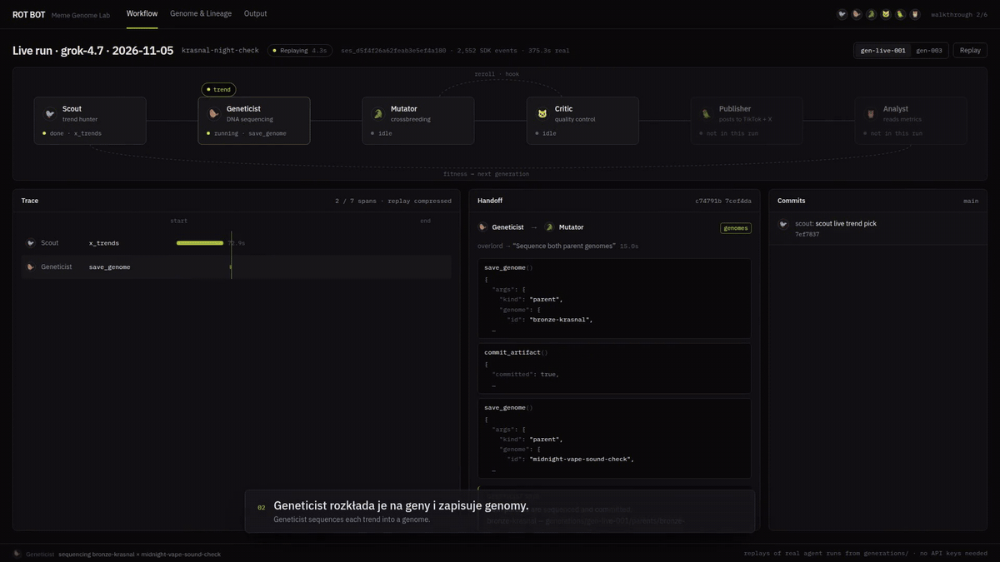</a>
</p>

<p align="center">
  <b><a href="docs/media/rotbot-demo-45s.mp4">▶ 45s demo</a></b>
  &nbsp;·&nbsp;
  <b><a href="https://wiktorzoga.github.io/opalacze/">Try it live</a></b>
</p>

## The ads it made

<table>
<tr>
<td align="center" width="33%">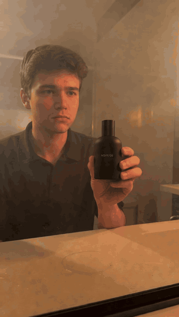<br><sub><b>live</b> · Ren Hale · NOIR/05</sub></td>
<td align="center" width="33%">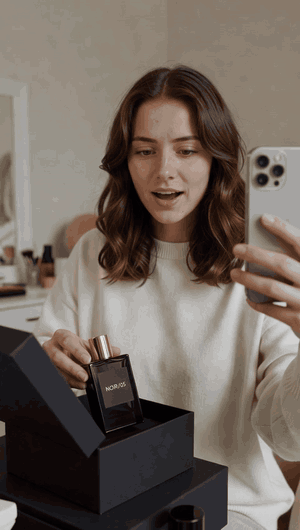<br><sub>Maja · NOIR/05 · unbox</sub></td>
<td align="center" width="33%">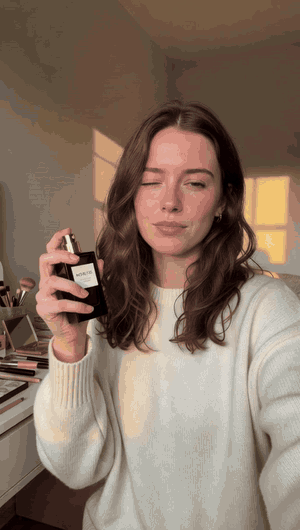<br><sub>Maja · NOIR/05 · GRWM</sub></td>
</tr>
<tr>
<td align="center">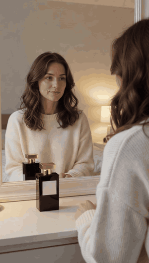<br><sub>Maja · NOIR/05 · mirror</sub></td>
<td align="center">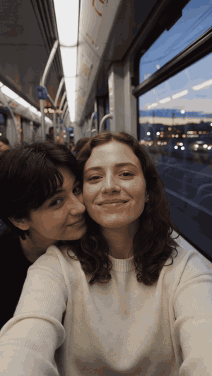<br><sub>Maja · NOIR/05 · tram</sub></td>
<td align="center">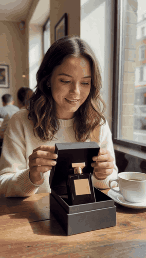<br><sub>Maja · NOIR/05 · café</sub></td>
</tr>
</table>

## From a trend to a client's ad

<table>
<tr>
<td width="16%" align="center" valign="middle"><svg width="40" height="40" viewBox="0 0 24 24" role="img" aria-label="TikTok"><path fill="#111" d="M19.59 6.69a4.83 4.83 0 0 1-3.77-4.25V2h-3.45v13.67a2.89 2.89 0 0 1-2.88 2.5 2.89 2.89 0 0 1-2.89-2.89 2.89 2.89 0 0 1 2.89-2.89c.28 0 .54.04.79.1V9.01a6.27 6.27 0 0 0-.79-.05 6.34 6.34 0 0 0-6.34 6.34 6.34 6.34 0 0 0 6.34 6.34 6.34 6.34 0 0 0 6.33-6.34V8.69a8.18 8.18 0 0 0 4.77 1.52V6.76a4.85 4.85 0 0 1-1-.07z"/></svg><br><sub>TikTok</sub></td>
<td width="16%" align="center" valign="middle"><svg width="40" height="40" viewBox="0 0 24 24" role="img" aria-label="X"><path fill="#111" d="M18.244 2.25h3.308l-7.227 8.26 8.502 11.24H16.17l-4.714-6.231-5.401 6.231H2.744l7.727-8.835L1.254 2.25H8.08l4.253 5.622L18.244 2.25zm-1.161 17.52h1.833L7.084 4.126H5.117z"/></svg><br><sub>X</sub></td>
<td width="16%" align="center" valign="middle"><svg width="40" height="40" viewBox="0 0 24 24" role="img" aria-label="Instagram"><path fill="#111" d="M12 2.163c3.204 0 3.584.012 4.85.07 3.252.148 4.771 1.691 4.919 4.919.058 1.265.069 1.645.069 4.849 0 3.205-.012 3.584-.069 4.849-.149 3.225-1.664 4.771-4.919 4.919-1.266.058-1.644.07-4.85.07-3.204 0-3.584-.012-4.849-.07-3.26-.149-4.771-1.699-4.919-4.92-.058-1.265-.07-1.644-.07-4.849 0-3.204.013-3.583.07-4.849.149-3.227 1.664-4.771 4.919-4.919 1.266-.057 1.645-.069 4.849-.069zM12 0C8.741 0 8.333.014 7.053.072 2.695.272.273 2.69.073 7.052.014 8.333 0 8.741 0 12c0 3.259.014 3.668.072 4.948.2 4.358 2.618 6.78 6.98 6.98 1.281.058 1.689.072 4.948.072 4.358-.2 6.78-2.618 6.98-6.98.058-1.28.072-1.689.072-4.948 0-3.259-.014-3.667-.072-4.947-.2-4.354-2.617-6.78-6.979-6.98C15.668.014 15.259 0 12 0zm0 5.838a6.162 6.162 0 1 0 0 12.324 6.162 6.162 0 0 0 0-12.324zM12 16a4 4 0 1 1 0-8 4 4 0 0 1 0 8zm6.406-11.845a1.44 1.44 0 1 0 0 2.881 1.44 1.44 0 0 0 0-2.881z"/></svg><br><sub>Instagram</sub></td>
<td width="6%" align="center" valign="middle"><b>→</b></td>
<td width="16%" align="center" valign="middle"><svg width="40" height="40" viewBox="0 0 24 24" role="img" aria-label="the swarm"><path fill="none" stroke="#0d9488" stroke-width="1.8" stroke-linecap="round" d="M2 16c2.5-3 4.2-3 6.2 0s3.6 3 6.2 0 3.7-3 6.4 0"/><path fill="none" stroke="#111" stroke-width="1.8" stroke-linecap="round" d="M2 11c2.5-3 4.2-3 6.2 0s3.6 3 6.2 0 3.7-3 6.4 0"/></svg><br><sub><b>the swarm</b></sub></td>
<td width="6%" align="center" valign="middle"><b>→</b></td>
<td width="16%" align="center" valign="middle"><svg width="28" height="44" viewBox="0 0 28 44" role="img" aria-label="client UGC"><rect x="1.5" y="1.5" width="25" height="41" rx="5" fill="none" stroke="#111" stroke-width="1.8"/><rect x="9" y="17" width="10" height="14" rx="1.5" fill="#0d9488"/></svg><br><sub><b>NOIR/05</b></sub></td>
</tr>
</table>

Scout watches TikTok, X and Instagram and catches a format on the rise: a deadpan phone clip, one line, then the product. Geneticist extracts its viral DNA, the hook, the pause, the late reveal. The client brief lands: NOIR/05, an eau de parfum, for Gen Z, in a UGC tone. Creator makes the ad in that format, Ren Hale and the black bottle, rendered by Grok Imagine. Critic checks brand safety and the `#ad` label. The ad is ready to ship.

<sub>Live today: Grok Bot, Grok Imagine, and X search. TikTok and Instagram are the distribution layer we're wiring next. We don't post yet.</sub>

## How it works

**One [Overlord](agents/bot/instructions.md) on `grok-4.7` delegates to six subagents. Every handoff is a real SDK `task` event in the [trace](generations/gen-live-002/trace.ndjson).**

<table>
<tr align="center">
<td width="16%">🐦<br><b><a href="agents/bot/subagents/scout/instructions.md">Scout</a></b><br><sub>picks the rising trend</sub><br><code>x_trends</code></td>
<td width="16%">🦫<br><b><a href="agents/bot/subagents/geneticist/instructions.md">Geneticist</a></b><br><sub>writes the trend DNA</sub><br><code>save_genome</code></td>
<td width="16%">🐊<br><b><a href="agents/bot/subagents/mutator/instructions.md">Creator</a></b><br><sub>renders the 9:16 ad</sub><br><code>generate_media</code></td>
<td width="16%">🐱<br><b><a href="agents/bot/subagents/critic/instructions.md">Critic</a></b><br><sub>blocks a bad disclosure</sub><br><code>commit_artifact</code></td>
<td width="16%">🦜<br><b><a href="agents/bot/subagents/publisher/instructions.md">Publisher</a></b><br><sub>queues TikTok and X</sub><br><code>commit_artifact</code></td>
<td width="16%">🦉<br><b><a href="agents/bot/subagents/analyst/instructions.md">Analyst</a></b><br><sub>scores the next variant</sub><br><code>commit_artifact</code></td>
</tr>
</table>

Each one commits the file it just made, under its own git name. Open [`agents/`](agents/) or the [live trace](generations/gen-live-002/trace.ndjson).

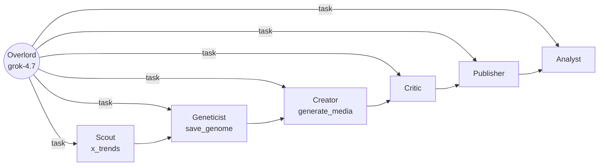

## Proof it's real

<table>
<tr>
<td width="50%" align="center" valign="top">

<a href="generations/gen-live-002/media/noir-05-deceive.mp4">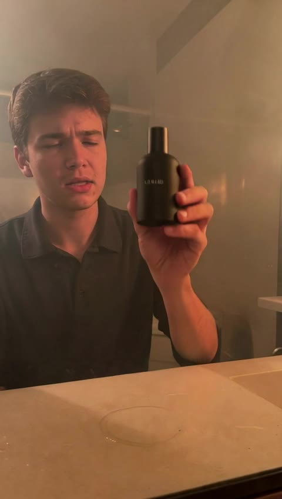</a>

<br>

**gen-live-002** · NOIR/05 brief

`grok-4.7` · 7 min · 5 handoffs · 4,167 events

> "All four scores clear 8, so I'm committing the approval."

[RUN.md](generations/gen-live-002/RUN.md) · [trace.ndjson](generations/gen-live-002/trace.ndjson) · [agent commits](https://github.com/WiktorZoga/opalacze/compare/2d31370~1...93a7265)

</td>
<td width="50%" align="center" valign="top">

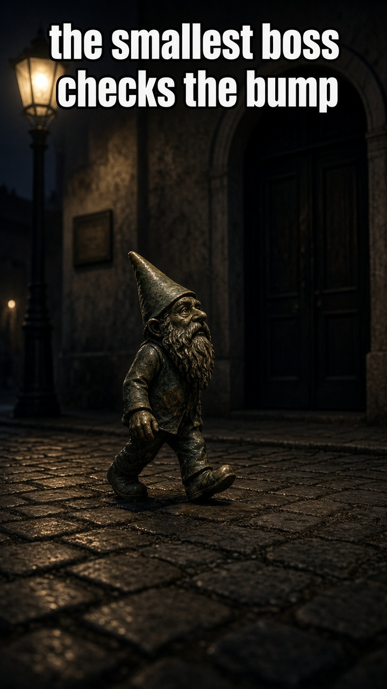

<br>

**gen-live-001** · first R&D run

`grok-4.7` · 6 min · 7 handoffs · 2,552 events

> "The thumb is gone and the hook is the dwarf."

[RUN.md](generations/gen-live-001/RUN.md) · [trace.ndjson](generations/gen-live-001/trace.ndjson) · [agent commits](https://github.com/WiktorZoga/opalacze/compare/f16e5c1~1...e2af1f7)

</td>
</tr>
</table>

### For marketing agencies

A brand sends a brief. The swarm finds a format that is rising on TikTok, X and Instagram, extracts its DNA, and ships trend-native UGC before the trend dies. Agencies need a week to jump on a format. Trends live three days. Riptide is the desk that does not wait.

### Under the hood

One Overlord, on `grok-4.7` through [`@grok/agent-sdk`](agents/), delegates to six subagents with the SDK `task` tool. Scout calls `x_trends`. Geneticist calls `save_genome`. Creator calls `generate_media`. Critic, Publisher and Analyst call `commit_artifact`, and each agent commits the file under its own git name.

Every handoff is an event in [`trace.ndjson`](generations/gen-live-002/trace.ndjson): `subagent.called`, `subagent.completed`, and the tool call between them. [gen-live-002](generations/gen-live-002/RUN.md) is 4,167 of those events. The Critic scored that run 9 / 9 / 10 / 10 and approved it on the first pass. The clip and the stills are `grok-imagine`. The same session, in the playground, is in [docs/media/grokbot/](docs/media/grokbot/).

Metrics and posting are simulated. The runs, the traces and the clips are real.

### The six roles

The [Overlord](agents/bot/instructions.md) takes the brief and hands each step off with `task`. [Scout](agents/bot/subagents/scout/instructions.md) ranks what is rising and scores brand fit. [Geneticist](agents/bot/subagents/geneticist/instructions.md) writes the eight-gene genome and the moment the product enters. [Creator](agents/bot/subagents/mutator/instructions.md) casts an AI persona and renders 9:16 variants. [Critic](agents/bot/subagents/critic/instructions.md) checks trend fidelity, claims and the `#ad · AI-generated` line, and sends a weak cut back. [Publisher](agents/bot/subagents/publisher/instructions.md) queues TikTok, Reels and X for a human to approve. [Analyst](agents/bot/subagents/analyst/instructions.md) reads hook rate, watch time and CTR and feeds the next variant. Tones are UGC, a polished ad, or Brainrot. Live integrations are Grok Bot, Grok Imagine and X search. Higgsfield, TikTok Creative Center, the ads APIs and ElevenLabs are next.

The same run, watched in the playground, is in [docs/media/grokbot/](docs/media/grokbot/), including the [60-second recording](docs/media/grokbot/grokbot-playground-live-run-2x.mp4). `npx agent-sdk validate --dir agents` passes. The project layout is in [agents/README.md](agents/README.md).

### Earlier runs

Before the agency brief, the swarm (R&D codename ROT BOT) learned trend DNA on real virals of the week, filed in [generations/](generations/) and [sources.json](generations/sources.json). Each crossover is a git merge, and the Critic's rejections are commits by the agent that made them. `git log --graph --format='%an: %s' -- generations/` is the family tree.

### Run it

```bash
cd agents && npm install && npx agent-sdk validate --dir .
export CURSOR_API_KEY=...  XAI_API_KEY=...
npx agent-sdk run --dir . --message "Brief: NOIR/05 eau de parfum, women 18-30, TikTok, tone UGC. Ship 2 variants."
npx agent-sdk dev

npm install && npm run dev
```


<sub>Riptide is run by a Grok Bot swarm. ROT BOT is the R&amp;D codename in older commits. Live runs are real; generations 001–003 are recorded runs over real trends; ad metrics are simulated. Creators are AI personas. [Team](TEAM.md) · [Presentation brief](docs/presentation-brief.md)</sub>
