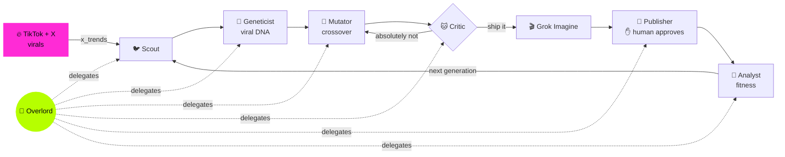

<p align="center">
  
</p>

<h3 align="center">Seven Grok Bot agents turn today's TikTok + X virals into brand-new content, on their own.</h3>

<p align="center">
  
  <a href="generations/gen-live-001/RUN.md"></a>
  <a href="https://wiktorzoga.github.io/opalacze/"></a>
</p>

<p align="center">
  <a href="docs/media/rotbot-demo-45s.mp4"></a>
</p>

<p align="center">
  <b><a href="docs/media/rotbot-demo-45s.mp4">▶ Watch the 45s demo</a></b> &nbsp;·&nbsp; <b><a href="https://wiktorzoga.github.io/opalacze/">🚀 Try it live</a></b>
</p>

## What it does

- 🔥 **Finds** real virals on TikTok and X (live xAI `x_search`).
- 🧬 **Extracts their viral DNA**: 8 genes per meme (hook, hero, humor, audio…).
- 🐊 **Breeds** two genomes into a new concept, and a 🐱 Critic rejects it until it's good.
- 🚀 **Renders, posts and learns**: Grok Imagine → TikTok / X → the fittest child parents the next generation.



## 🔴 Live run: real, not simulated

<table>
<tr>
<td width="30%" valign="top">
  
</td>
<td valign="top">

**`grok-4.7` · 6 min · 7 subagent handoffs · 2,552 events.** Live X trend *"Hitting Vape to Investigate Night Sound"*
(683k views) × a Wrocław dwarf → *"the smallest boss checks the bump"*, rendered by Grok Imagine.

> 🐱 *"The hook is still the father's thumb on a statue that has none. First draft fails freshness, so this does not ship."*
>
> 🐱 *"The thumb is gone and the hook is the dwarf."*
>
> 🐙 *"Eight hundred bosses, one doorway, zero permission asked."*

📄 [RUN.md](generations/gen-live-001/RUN.md) · 🧾 [trace.ndjson](generations/gen-live-001/trace.ndjson) · 🌱 [agent commits](https://github.com/WiktorZoga/opalacze/compare/f16e5c1~1...e2af1f7)

</td>
</tr>
</table>

## Every agent commits as itself

The git history is the meme family tree: each artifact is committed by the agent that made it, and every crossover is a `git merge`.

| Gen | Parents | Child | Critic | Fitness |
| :---: | --- | --- | --- | :---: |
| [001](generations/gen-001/) | Scientists Reveal the Hi × Black Cat Clapping | **Scientists Reveal the Clap** | ❌ → ✅ | 0.48 |
| [002](generations/gen-002/) | Wrocław Krasnal *(brand)* × gen-001 | **Krasnal CEO** | ✅ | 0.63 |
| [003](generations/gen-003/) | Krasnal CEO × Why Would I Deceive You? | **Krasnal CEO: Series A** | ❌ → ✅ | **0.81** |
| [🔴 live](generations/gen-live-001/) | Wrocław Krasnal × Night Sound Vape *(live x_search)* | **Krasnal Night Check** | ❌ → ✅ | — |

<details>
<summary><b>🌳 See the git graph</b></summary>

```text
*   Mutator 🐊: crossover krasnal-ceo × why-would-i-deceive-you → krasnal-ceo-series-a
|\
| * Geneticist 🦫: sequence why-would-i-deceive-you genome
* | Geneticist 🦫: sequence krasnal-ceo genome
|/
* Scout 🐦: spot why-would-i-deceive-you for the krasnal-ceo bloodline
* Analyst 🦉: fitness krasnal-ceo = 0.63
  ...
*   Mutator 🐊: crossover krasnal-wroclaw × scientists-reveal-the-clap → krasnal-ceo
|\
| * Geneticist 🦫: sequence scientists-reveal-the-clap genome
* | Geneticist 🦫: sequence krasnal-wroclaw genome
|/
* Overlord 🐙: open gen-002: BRANDROT brief for Wrocław
  ...
* Critic 🐱: absolutely not (hero)
*   Mutator 🐊: crossover scientists-reveal-the-hi × black-cat-clapping → scientists-reveal-the-clap
|\
| * Geneticist 🦫: sequence black-cat-clapping genome
* | Geneticist 🦫: sequence scientists-reveal-the-hi genome
|/
* Scout 🐦: record run scout-2026-11-05: 10 real trends from TikTok + X
```

Reproduce: `git log --graph --format='%an: %s' -- generations/`. Real sources: [`generations/sources.json`](generations/sources.json).

</details>

<details>
<summary><b>🔍 Inside Grok Bot: playground and trace</b></summary>

<p align="center">
  <br>
  <sub>Demo session at 2× speed. <a href="docs/media/grokbot/grokbot-playground-live-run-2x.mp4">▶ MP4 (60 s)</a></sub>
</p>

<table>
<tr>
<td width="50%" valign="top"><br><sub>🐙 Live run report: 7 handoff cards and the agent panel.</sub></td>
<td width="50%" valign="top"><br><sub>🐦 Overlord → Scout: 63 tool calls, live <code>x_trends</code> in 48.5 s.</sub></td>
</tr>
<tr>
<td width="50%" valign="top"><br><sub>🦫🐊 Geneticist → Mutator: sequence, then cross.</sub></td>
<td width="50%" valign="top"><br><sub>🐱 "absolutely not", then the hook is rerolled.</sub></td>
</tr>
<tr>
<td width="50%" valign="top"><br><sub>🐱 <code>commit_artifact</code>: the Critic commits its verdict.</sub></td>
<td width="50%" valign="top"><br><sub>🐊 <code>generate_media</code>: Grok Imagine render.</sub></td>
</tr>
</table>

</details>

<details>
<summary><b>🎭 The cast: 7 agents</b></summary>

| | Agent | Job | Signature move |
| :---: | --- | --- | --- |
| 🐙 | [Overlord](agents/bot/instructions.md) | orchestrates the loop via `task` | eight arms, seven employees |
| 🐦 | [Scout](agents/bot/subagents/scout/instructions.md) | `x_trends`, picks parents by velocity | coos once per report |
| 🦫 | [Geneticist](agents/bot/subagents/geneticist/instructions.md) | 8-gene genomes, `save_genome` | finds the meme's soul gene |
| 🐊 | [Mutator](agents/bot/subagents/mutator/instructions.md) | crossover, mutations, git merge, `generate_media` | laughs in three syllables |
| 🐱 | [Critic](agents/bot/subagents/critic/instructions.md) | funny / fresh / loopable / brand-safe | *"absolutely not"* |
| 🦜 | [Publisher](agents/bot/subagents/publisher/instructions.md) | TikTok + X posts, `publish_post` (human approval) | squawks while waiting |
| 🦉 | [Analyst](agents/bot/subagents/analyst/instructions.md) | fitness from watch-through, shares, saves | one owl joke, never two |

</details>

<details>
<summary><b>🧩 Built on Grok Bot: project layout</b></summary>

[`agents/`](agents/) is a real [`@grok/agent-sdk`](https://cursor.com/docs/bdk) project (passes `agent-sdk validate`):

```text
agents/bot/
├── agent.ts, instructions.md     # 🐙 Overlord (grok-4.7)
├── subagents/                    # scout · geneticist · mutator · critic · publisher · analyst
├── tools/
│   ├── x_trends.ts               # xAI x_search
│   ├── save_genome.ts            # zod-validated viral DNA
│   ├── generate_media.ts         # Grok Imagine
│   ├── commit_artifact.ts        # git commit as the agent; crossover = merge
│   └── publish_post.ts           # X API, needsApproval
├── skills/brandrot.md            # brand mode
├── schedules/next-generation.md  # every 6 h
└── hooks/memory.ts               # remembers the bloodline
```

More: [`agents/README.md`](agents/README.md).

</details>

<details>
<summary><b>🧬 Viral DNA: a sample genome</b></summary>

[`generations/gen-003/mutation.json`](generations/gen-003/mutation.json), trimmed:

```json
{
  "id": "krasnal-ceo-series-a",
  "parents": ["krasnal-ceo", "why-would-i-deceive-you"],
  "genes": {
    "hook":        { "allele": "pitch slide: 'we are not a dwarf, we are a Small Language Model'", "dominance": 0.85 },
    "hero":        { "allele": "bronze krasnal CEO in a tiny fleece vest", "dominance": 0.95 },
    "humor":       { "allele": "deadpan irony: confident promise, guaranteed disappointment", "dominance": 0.95 },
    "catchphrase": { "allele": "Why would a dwarf deceive you?", "dominance": 0.9 },
    "structure":   { "allele": "pitch → catchphrase → black cat claps → loop", "dominance": 0.85 }
  },
  "mutations": [
    { "gene": "structure", "to": "… → black cat claps → loop", "reason": "Critic: 'it ends. memes must not end.'" }
  ]
}
```

</details>

<details>
<summary><b>📱 App screens</b></summary>

| Trend Radar | Breeding | Publish + Metrics |
| :---: | :---: | :---: |
|  |  |  |

</details>

## 💼 BRANDROT: turn any brand into brainrot

Agencies need two weeks for one on-trend video; trends die in five days. BRANDROT makes the brand a seed genome that
survives every crossover and ships a new on-trend post every 6 hours, with a human approving each one.
Example: brief *Wrocław* → **Krasnal CEO**. [Pitch →](docs/pitch.md)

## Quickstart

```bash
cd agents && npm install && npx agent-sdk validate --dir .
export CURSOR_API_KEY=...  XAI_API_KEY=...
npx agent-sdk run --dir . --message "Breed the next generation."
npx agent-sdk dev                  # Grok Bot playground

npm install && npm run dev         # the app (repo root)
```

<sub>`gen-live-001` is a real end-to-end run; generations 001–003 are recorded agent runs over real, linked trends with projected metrics. Team: [TEAM.md](TEAM.md).</sub>
