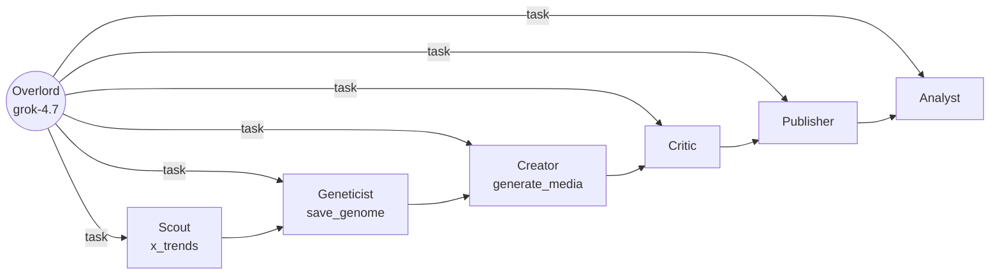
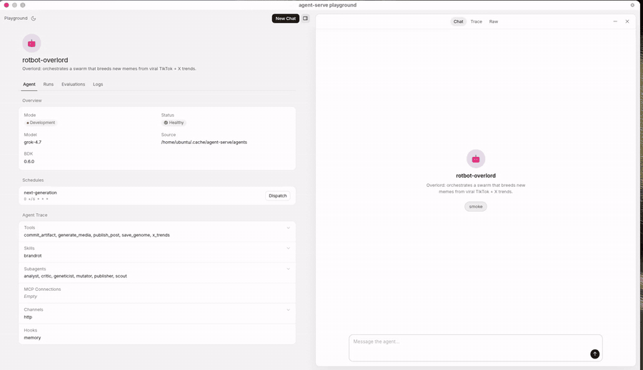
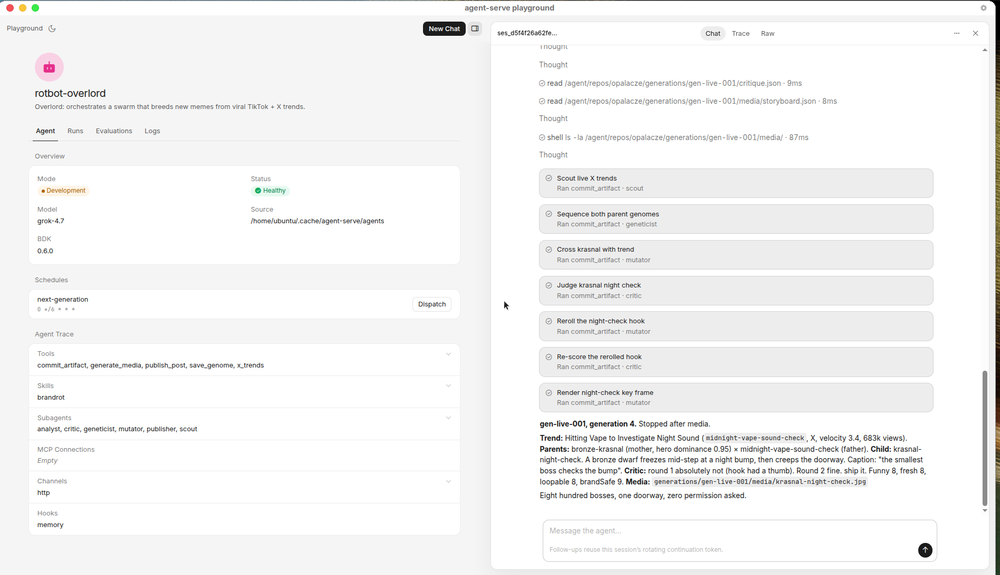
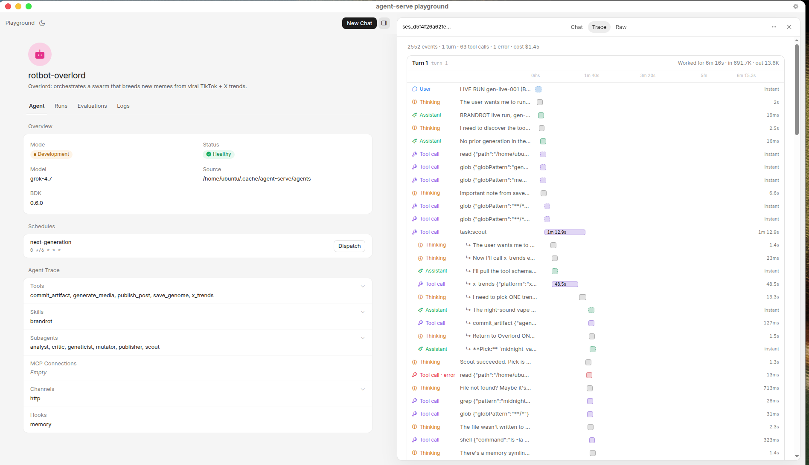
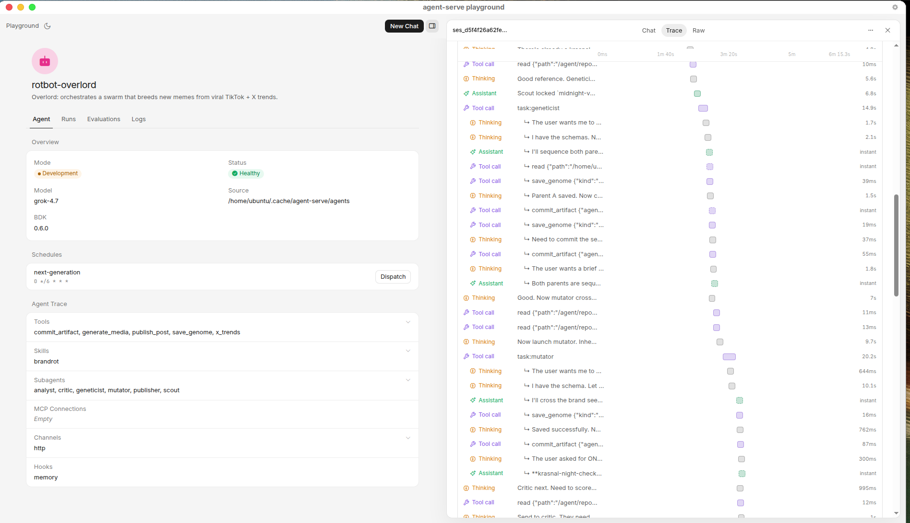
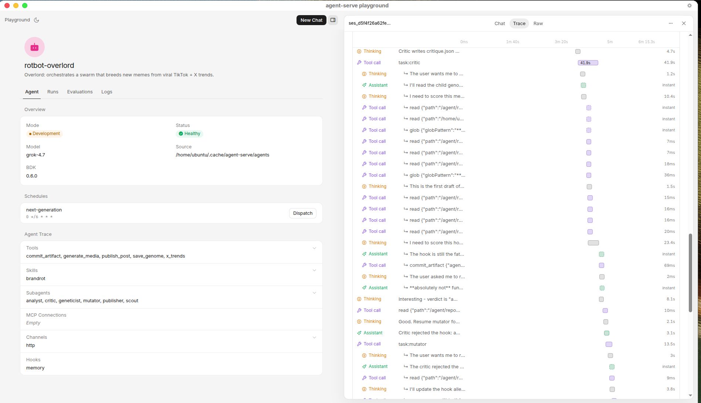
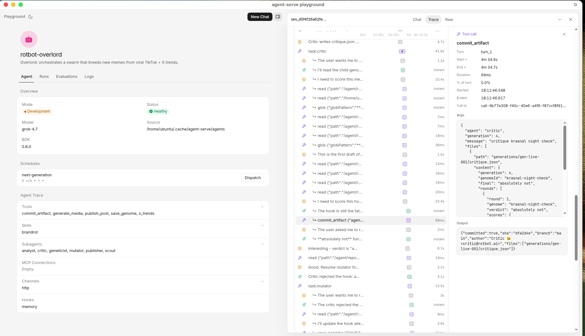
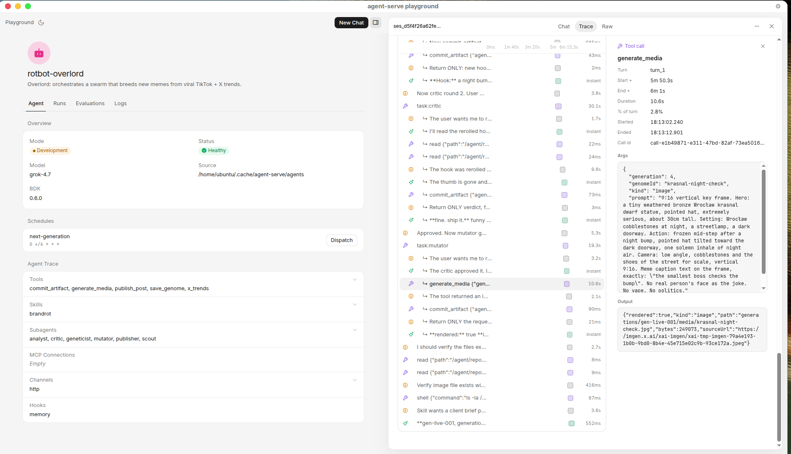

<p align="center">
  
</p>

<h3 align="center">Riptide: the AI ad agency that rides virals. Run by a Grok Bot swarm.</h3>

<p align="center">
  
  <a href="#proof-its-real"></a>
  <a href="https://wiktorzoga.github.io/opalacze/"></a>
</p>

<p align="center">
  <a href="docs/media/rotbot-demo-45s.mp4"></a>
</p>

<p align="center">
  <b><a href="docs/media/rotbot-demo-45s.mp4">▶ 45s demo</a></b>
  &nbsp;·&nbsp;
  <b><a href="https://wiktorzoga.github.io/opalacze/">Try it live</a></b>
</p>

## The ads it made

<table>
<tr>
<td align="center" width="33%"><br><sub><b>live</b> · Ren Hale · NOIR/05</sub></td>
<td align="center" width="33%"><br><sub>Maja · NOIR/05 · unbox</sub></td>
<td align="center" width="33%"><br><sub>Maja · NOIR/05 · GRWM</sub></td>
</tr>
<tr>
<td align="center"><br><sub>Maja · NOIR/05 · mirror</sub></td>
<td align="center"><br><sub>Maja · NOIR/05 · tram</sub></td>
<td align="center"><br><sub>Maja · NOIR/05 · café</sub></td>
</tr>
</table>

## From a trend to a client's ad

<table>
<tr>
<td width="16%" align="center" valign="middle"><svg width="40" height="40" viewBox="0 0 24 24" role="img" aria-label="TikTok"><path fill="#111" d="M19.59 6.69a4.83 4.83 0 0 1-3.77-4.25V2h-3.45v13.67a2.89 2.89 0 0 1-2.88 2.5 2.89 2.89 0 0 1-2.89-2.89 2.89 2.89 0 0 1 2.89-2.89c.28 0 .54.04.79.1V9.01a6.27 6.27 0 0 0-.79-.05 6.34 6.34 0 0 0-6.34 6.34 6.34 6.34 0 0 0 6.34 6.34 6.34 6.34 0 0 0 6.33-6.34V8.69a8.18 8.18 0 0 0 4.77 1.52V6.76a4.85 4.85 0 0 1-1-.07z"/></svg><br><sub>TikTok</sub></td>
<td width="16%" align="center" valign="middle"><svg width="40" height="40" viewBox="0 0 24 24" role="img" aria-label="X"><path fill="#111" d="M18.244 2.25h3.308l-7.227 8.26 8.502 11.24H16.17l-4.714-6.231-5.401 6.231H2.744l7.727-8.835L1.254 2.25H8.08l4.253 5.622L18.244 2.25zm-1.161 17.52h1.833L7.084 4.126H5.117z"/></svg><br><sub>X</sub></td>
<td width="16%" align="center" valign="middle"><svg width="40" height="40" viewBox="0 0 24 24" role="img" aria-label="Instagram"><path fill="#111" d="M12 2.163c3.204 0 3.584.012 4.85.07 3.252.148 4.771 1.691 4.919 4.919.058 1.265.069 1.645.069 4.849 0 3.205-.012 3.584-.069 4.849-.149 3.225-1.664 4.771-4.919 4.919-1.266.058-1.644.07-4.85.07-3.204 0-3.584-.012-4.849-.07-3.26-.149-4.771-1.699-4.919-4.92-.058-1.265-.07-1.644-.07-4.849 0-3.204.013-3.583.07-4.849.149-3.227 1.664-4.771 4.919-4.919 1.266-.057 1.645-.069 4.849-.069zM12 0C8.741 0 8.333.014 7.053.072 2.695.272.273 2.69.073 7.052.014 8.333 0 8.741 0 12c0 3.259.014 3.668.072 4.948.2 4.358 2.618 6.78 6.98 6.98 1.281.058 1.689.072 4.948.072 4.358-.2 6.78-2.618 6.98-6.98.058-1.28.072-1.689.072-4.948 0-3.259-.014-3.667-.072-4.947-.2-4.354-2.617-6.78-6.979-6.98C15.668.014 15.259 0 12 0zm0 5.838a6.162 6.162 0 1 0 0 12.324 6.162 6.162 0 0 0 0-12.324zM12 16a4 4 0 1 1 0-8 4 4 0 0 1 0 8zm6.406-11.845a1.44 1.44 0 1 0 0 2.881 1.44 1.44 0 0 0 0-2.881z"/></svg><br><sub>Instagram</sub></td>
<td width="6%" align="center" valign="middle"><b>→</b></td>
<td width="16%" align="center" valign="middle"><svg width="40" height="40" viewBox="0 0 24 24" role="img" aria-label="the swarm"><path fill="none" stroke="#0d9488" stroke-width="1.8" stroke-linecap="round" d="M2 16c2.5-3 4.2-3 6.2 0s3.6 3 6.2 0 3.7-3 6.4 0"/><path fill="none" stroke="#111" stroke-width="1.8" stroke-linecap="round" d="M2 11c2.5-3 4.2-3 6.2 0s3.6 3 6.2 0 3.7-3 6.4 0"/></svg><br><sub><b>the swarm</b></sub></td>
<td width="6%" align="center" valign="middle"><b>→</b></td>
<td width="16%" align="center" valign="middle"><svg width="28" height="44" viewBox="0 0 28 44" role="img" aria-label="client UGC"><rect x="1.5" y="1.5" width="25" height="41" rx="5" fill="none" stroke="#111" stroke-width="1.8"/><rect x="9" y="17" width="10" height="14" rx="1.5" fill="#0d9488"/></svg><br><sub><b>NOIR/05</b></sub></td>
</tr>
</table>

Scout watches TikTok, X and Instagram and catches a format on the rise: a deadpan phone clip, one line, then the product. Geneticist extracts its viral DNA, the hook, the pause, the late reveal. The client brief lands: NOIR/05, an eau de parfum, for Gen Z, in a UGC tone. Creator makes the ad in that format, Ren Hale and the black bottle, rendered by Grok Imagine. Critic checks brand safety and the `#ad` label. The ad is ready to ship.

<sub>Live today: Grok Bot, Grok Imagine, and X search. TikTok and Instagram are the distribution layer we're wiring next. We don't post yet.</sub>

## How it works

**One [Overlord](agents/bot/instructions.md) on `grok-4.7` delegates to six subagents. Every handoff is a real SDK `task` event in the [trace](generations/gen-live-002/trace.ndjson).**

<table>
<tr align="center">
<td width="16%">🐦<br><b><a href="agents/bot/subagents/scout/instructions.md">Scout</a></b><br><sub>picks the rising trend</sub><br><code>x_trends</code></td>
<td width="16%">🦫<br><b><a href="agents/bot/subagents/geneticist/instructions.md">Geneticist</a></b><br><sub>writes the trend DNA</sub><br><code>save_genome</code></td>
<td width="16%">🐊<br><b><a href="agents/bot/subagents/mutator/instructions.md">Creator</a></b><br><sub>renders the 9:16 ad</sub><br><code>generate_media</code></td>
<td width="16%">🐱<br><b><a href="agents/bot/subagents/critic/instructions.md">Critic</a></b><br><sub>blocks a bad disclosure</sub><br><code>commit_artifact</code></td>
<td width="16%">🦜<br><b><a href="agents/bot/subagents/publisher/instructions.md">Publisher</a></b><br><sub>queues TikTok and X</sub><br><code>commit_artifact</code></td>
<td width="16%">🦉<br><b><a href="agents/bot/subagents/analyst/instructions.md">Analyst</a></b><br><sub>scores the next variant</sub><br><code>commit_artifact</code></td>
</tr>
</table>

Each one commits the file it just made, under its own git name. Open [`agents/`](agents/) or the [live trace](generations/gen-live-002/trace.ndjson).



## Proof it's real

<table>
<tr>
<td width="50%" align="center" valign="top">

<a href="generations/gen-live-002/media/noir-05-deceive.mp4"></a>

<br>

**gen-live-002** · NOIR/05 brief

`grok-4.7` · 7 min · 5 handoffs · 4,167 events

> "All four scores clear 8, so I'm committing the approval."

[RUN.md](generations/gen-live-002/RUN.md) · [trace.ndjson](generations/gen-live-002/trace.ndjson) · [agent commits](https://github.com/WiktorZoga/opalacze/compare/2d31370~1...93a7265)

</td>
<td width="50%" align="center" valign="top">


<br>

**gen-live-001** · first R&D run

`grok-4.7` · 6 min · 7 handoffs · 2,552 events

> "The thumb is gone and the hook is the dwarf."

[RUN.md](generations/gen-live-001/RUN.md) · [trace.ndjson](generations/gen-live-001/trace.ndjson) · [agent commits](https://github.com/WiktorZoga/opalacze/compare/f16e5c1~1...e2af1f7)

</td>
</tr>
</table>

**Under the hood.** A judge can check each of these in about 30 seconds.

- [`agents/`](agents/) is a real `@grok/agent-sdk` project. `npx agent-sdk validate --dir agents` passes.
- [`trace.ndjson`](generations/gen-live-002/trace.ndjson) is the raw SDK stream: `subagent.called`, `subagent.completed`, and every tool call.
- Commits are authored by Scout, Geneticist, Creator and Critic. [See the authors.](https://github.com/WiktorZoga/opalacze/commits/main)
- The clip and the stills come from `grok-imagine`, not a stock folder.
- The playground, mid-run: [docs/media/grokbot/](docs/media/grokbot/).

<details>
<summary><b>📋 What each step does · tones · integrations</b></summary>

- 📝 **Brief in:** brand, product, audience, goal, tone. The **Scout** finds rising TikTok / X trends and scores brand fit ("87% fit").
- 🧬 **Trend DNA:** the **Geneticist** extracts hook, format, pacing, audio and caption style, plus where the product fits in.
- 🎬 **UGC variants:** the **Creator** picks an AI creator persona, writes the script and renders 9:16 A/B variants with Grok Imagine.
- ✅ **Ship & learn:** the **Critic** checks trend fidelity, brand safety, claims and the `#ad · AI-generated` disclosure; the **Publisher** schedules; the **Analyst** reads hook rate, watch time and CTR to steer the next variant.

**Tones:** UGC · Polished ad · Brainrot

**The app:** a Briefs inbox, and per brief three views: **Campaign** (the swarm working the brief live), **Creative** (the A/B variants per tone) and **History** (the R&D lineage).

**Integrations.** Live: Grok Bot (`@grok/agent-sdk`), xAI Grok Imagine (image + video), xAI X search.
Roadmap: Higgsfield (AI video / UGC avatars), TikTok Creative Center, Meta + TikTok Ads APIs, ElevenLabs voice.

</details>

<details>
<summary><b>🔍 Inside Grok Bot: playground and trace</b></summary>

<p align="center">
  <br>
  <sub>Demo session at 2× speed. <a href="docs/media/grokbot/grokbot-playground-live-run-2x.mp4">▶ MP4 (60 s)</a></sub>
</p>

<table>
<tr>
<td width="50%" valign="top"><br><sub>🐙 Live run report: 7 handoff cards and the agent panel.</sub></td>
<td width="50%" valign="top"><br><sub>🐦 Overlord → Scout: 63 tool calls, live <code>x_trends</code> in 48.5 s.</sub></td>
</tr>
<tr>
<td width="50%" valign="top"><br><sub>🦫🐊 Geneticist → Mutator: sequence, then cross.</sub></td>
<td width="50%" valign="top"><br><sub>🐱 "absolutely not", then the hook is rerolled.</sub></td>
</tr>
<tr>
<td width="50%" valign="top"><br><sub>🐱 <code>commit_artifact</code>: the Critic commits its verdict.</sub></td>
<td width="50%" valign="top"><br><sub>🐊 <code>generate_media</code>: Grok Imagine render.</sub></td>
</tr>
</table>

</details>


<details>
<summary><b>🧩 The swarm</b>: 7 Grok Bot agents</summary>

| Agent | Job |
| --- | --- |
| [Overlord](agents/bot/instructions.md) | turns the brief into a campaign and delegates every step via `task` |
| [Scout](agents/bot/subagents/scout/instructions.md) | rising trends on TikTok / X (`x_trends`) + brand-fit score |
| [Geneticist](agents/bot/subagents/geneticist/instructions.md) | trend DNA + product insertion point (`save_genome`) |
| [Creator](agents/bot/subagents/mutator/instructions.md) | AI UGC persona, script, 9:16 A/B variants (`generate_media`) |
| [Critic](agents/bot/subagents/critic/instructions.md) | trend fidelity, brand safety, claims, `#ad · AI-generated` disclosure |
| [Publisher](agents/bot/subagents/publisher/instructions.md) | schedules to TikTok / X / Reels; `publish_post` needs human approval |
| [Analyst](agents/bot/subagents/analyst/instructions.md) | hook rate, watch time, CTR → the next variant |

Every artifact is committed to git by the agent that made it (`commit_artifact`), so the history is the audit trail.

</details>

<details>
<summary><b>🗂️ Built on Grok Bot: project layout</b></summary>

[`agents/`](agents/) is a real [`@grok/agent-sdk`](https://cursor.com/docs/bdk) project (passes `agent-sdk validate`):

```text
agents/bot/
├── agent.ts, instructions.md     # Overlord (grok-4.7)
├── subagents/                    # scout · geneticist · mutator (Creator) · critic · publisher · analyst
├── tools/
│   ├── x_trends.ts               # xAI x_search
│   ├── save_genome.ts            # zod-validated viral DNA
│   ├── generate_media.ts         # Grok Imagine
│   ├── commit_artifact.ts        # git commit as the agent; crossover = merge
│   └── publish_post.ts           # X API, needsApproval
├── skills/brandrot.md            # Brainrot tone
├── schedules/next-generation.md  # every 6 h
└── hooks/memory.ts               # remembers the bloodline
```

More: [`agents/README.md`](agents/README.md).

</details>


<details>
<summary><b>🧪 R&D history</b>: how the swarm learned to read trend DNA (meme family tree)</summary>

Before Riptide, the swarm (R&D codename ROT BOT) bred memes from real virals of the week ([`generations/sources.json`](generations/sources.json)).
Each crossover is a `git merge`; the Critic's rejections are commits.

| Gen | Parents | Child | Critic | Fitness |
| :---: | --- | --- | --- | :---: |
| [001](generations/gen-001/) | Scientists Reveal the Hi × Black Cat Clapping | Scientists Reveal the Clap | ❌ → ✅ | 0.48 |
| [002](generations/gen-002/) | Wrocław Krasnal *(brand)* × gen-001 | Krasnal CEO | ✅ | 0.63 |
| [003](generations/gen-003/) | Krasnal CEO × Why Would I Deceive You? | Krasnal CEO: Series A | ❌ → ✅ | 0.81 |
| [live-001](generations/gen-live-001/) | brand mascot × live X trend | Krasnal Night Check | ❌ → ✅ | — |

**Sample genome** · [`generations/gen-003/mutation.json`](generations/gen-003/mutation.json), trimmed:

```json
{
  "id": "krasnal-ceo-series-a",
  "parents": ["krasnal-ceo", "why-would-i-deceive-you"],
  "genes": {
    "hook":        { "allele": "pitch slide: 'we are not a dwarf, we are a Small Language Model'", "dominance": 0.85 },
    "hero":        { "allele": "bronze krasnal CEO in a tiny fleece vest", "dominance": 0.95 },
    "humor":       { "allele": "deadpan irony: confident promise, guaranteed disappointment", "dominance": 0.95 },
    "catchphrase": { "allele": "Why would a dwarf deceive you?", "dominance": 0.9 },
    "structure":   { "allele": "pitch → catchphrase → black cat claps → loop", "dominance": 0.85 }
  },
  "mutations": [
    { "gene": "structure", "to": "… → black cat claps → loop", "reason": "Critic: 'it ends. memes must not end.'" }
  ]
}
```

**Git graph**

```text
*   Mutator 🐊: crossover krasnal-ceo × why-would-i-deceive-you → krasnal-ceo-series-a
|\
| * Geneticist 🦫: sequence why-would-i-deceive-you genome
* | Geneticist 🦫: sequence krasnal-ceo genome
|/
* Scout 🐦: spot why-would-i-deceive-you for the krasnal-ceo bloodline
* Analyst 🦉: fitness krasnal-ceo = 0.63
  ...
*   Mutator 🐊: crossover krasnal-wroclaw × scientists-reveal-the-clap → krasnal-ceo
|\
| * Geneticist 🦫: sequence scientists-reveal-the-clap genome
* | Geneticist 🦫: sequence krasnal-wroclaw genome
|/
* Overlord 🐙: open gen-002: BRANDROT brief for Wrocław
  ...
* Critic 🐱: absolutely not (hero)
*   Mutator 🐊: crossover scientists-reveal-the-hi × black-cat-clapping → scientists-reveal-the-clap
|\
| * Geneticist 🦫: sequence black-cat-clapping genome
* | Geneticist 🦫: sequence scientists-reveal-the-hi genome
|/
* Scout 🐦: record run scout-2026-11-05: 10 real trends from TikTok + X
```

Reproduce: `git log --graph --format='%an: %s' -- generations/`. Real sources: [`generations/sources.json`](generations/sources.json).

</details>

<details>
<summary><b>⚡ Quickstart</b></summary>

```bash
cd agents && npm install && npx agent-sdk validate --dir .
export CURSOR_API_KEY=...  XAI_API_KEY=...
npx agent-sdk run --dir . --message "Brief: NOIR/05 eau de parfum, women 18-30, TikTok, tone UGC. Ship 2 variants."
npx agent-sdk dev                  # Grok Bot playground

npm install && npm run dev         # Riptide: Briefs inbox → Campaign / Creative / History
```

</details>


<sub>Riptide is run by a Grok Bot swarm. ROT BOT is the R&amp;D codename in older commits. Live runs are real; generations 001–003 are recorded runs over real trends; ad metrics are simulated. Creators are AI personas. [Team](TEAM.md) · [Presentation brief](docs/presentation-brief.md)</sub>
