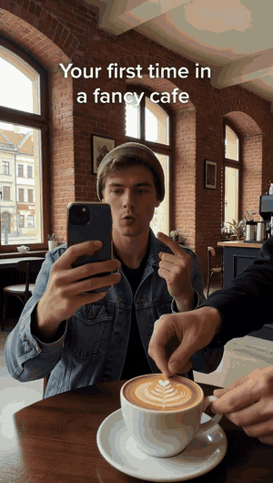
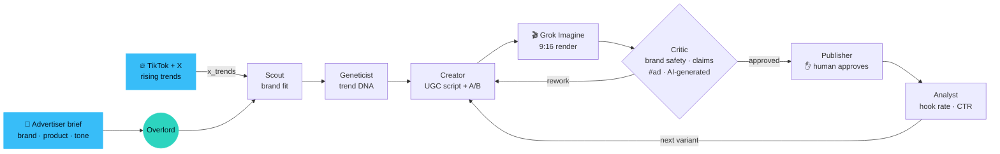

<p align="center">
  
</p>

<h3 align="center">Riptide: the AI ad agency that rides virals. Run by a Grok Bot swarm.</h3>
<p align="center">Brands send a brief; a swarm of Grok Bot agents finds the rising trend, extracts its DNA and ships trend-native UGC ads in minutes.</p>

<p align="center">
  
  <a href="#-live-runs-real-not-simulated"></a>
  <a href="https://wiktorzoga.github.io/opalacze/"></a>
</p>

<p align="center">
  <a href="docs/media/rotbot-demo-45s.mp4"></a>
</p>

<p align="center">
  <b><a href="docs/media/rotbot-demo-45s.mp4">▶ Watch the 45s demo</a></b> &nbsp;·&nbsp; <b><a href="https://wiktorzoga.github.io/opalacze/">🚀 Try it live</a></b>
</p>

## The ads it made

<table>
<tr>
<td align="center" valign="top" width="20%"><br><sub><b>🔴 live run</b><br>Ren Hale · “Why would I deceive you?” · UGC<br><code>#ad · AI-generated</code></sub></td>
<td align="center" valign="top" width="20%"><br><sub>Maja · unboxing · UGC<br><code>#ad · AI-generated</code></sub></td>
<td align="center" valign="top" width="20%"><br><sub>Maja · get ready with me · UGC<br><code>#ad · AI-generated</code></sub></td>
<td align="center" valign="top" width="20%"><br><sub>Capybara mascot · dramatic spritz · Brainrot<br><code>#ad · AI-generated</code></sub></td>
<td align="center" valign="top" width="20%"><br><sub>Kuba · first time in a fancy café · UGC<br><code>#ad · AI-generated</code></sub></td>
</tr>
</table>

<sub>NOIR/05 is a fictional perfume brand; all creators are AI personas rendered with Grok Imagine.</sub>

## How the swarm works

**Why:** agencies need a week to jump on a trend that lives 3 days. Riptide ships trend-matched ads while the trend is still rising.



## 🔴 Live runs: real, not simulated

<table>
<tr>
<td width="30%" valign="top">
  <a href="generations/gen-live-002/media/noir-05-deceive.mp4"></a><br>
  <sub><a href="generations/gen-live-002/media/noir-05-deceive.mp4">▶ Play the clip</a> · Grok Imagine video, 9:16 · <code>#ad · AI-generated</code></sub>
</td>
<td valign="top">

**gen-live-002: NOIR/05 eau de parfum, UGC brief.** `grok-4.7` · 7 min · 5 subagent handoffs · 4,167 events.
Trend *"Why Would I Deceive You?"* at **84% brand fit** (picked from the Scout's recorded snapshot of real trends;
live X search returned nothing usable). AI creator persona **Ren Hale**. Critic approved on the first round:
trend fidelity 9 · brand safety 9 · claims 10 · disclosure 10.

> 🐦 *"Deadpan letdown text already fits a 7-second phone caption, and the black bottle can be the only thing in frame that refuses to disappoint."*
>
> 🐱 *"The script hits the deadpan line, the late bottle, scent notes only, and the exact disclosure on screen and in the caption. All four scores clear 8, so I'm committing the approval."*
>
> 🐙 *"Eight arms, one bottle, zero polish. We don't follow trends. We mutate them."*

📄 [RUN.md](generations/gen-live-002/RUN.md) · 🧾 [trace.ndjson](generations/gen-live-002/trace.ndjson) · 📝 [brief](generations/gen-live-002/brief.json) · 🎬 [script](generations/gen-live-002/script.json) · 🌱 [agent commits](https://github.com/WiktorZoga/opalacze/compare/2d31370~1...93a7265)

</td>
</tr>
</table>

<details>
<summary><b>gen-live-001: the first R&D run</b></summary>

<table>
<tr>
<td width="30%" valign="top">
  
</td>
<td valign="top">

**gen-live-001: the first R&D run.** `grok-4.7` · 6 min · 7 subagent handoffs · 2,552 events. A live X trend
*"Hitting Vape to Investigate Night Sound"* (683k views) × a brand mascot, rendered by Grok Imagine.

> 🐱 *"The hook is still the father's thumb on a statue that has none. First draft fails freshness, so this does not ship."*
>
> 🐱 *"The thumb is gone and the hook is the dwarf."*
>
> 🐙 *"Eight hundred bosses, one doorway, zero permission asked."*

📄 [RUN.md](generations/gen-live-001/RUN.md) · 🧾 [trace.ndjson](generations/gen-live-001/trace.ndjson) · 🌱 [agent commits](https://github.com/WiktorZoga/opalacze/compare/f16e5c1~1...e2af1f7)

</td>
</tr>
</table>

</details>

<details>
<summary><b>📋 What each step does · tones · integrations</b></summary>

- 📝 **Brief in:** brand, product, audience, goal, tone. The **Scout** finds rising TikTok / X trends and scores brand fit ("87% fit").
- 🧬 **Trend DNA:** the **Geneticist** extracts hook, format, pacing, audio and caption style, plus where the product fits in.
- 🎬 **UGC variants:** the **Creator** picks an AI creator persona, writes the script and renders 9:16 A/B variants with Grok Imagine.
- ✅ **Ship & learn:** the **Critic** checks trend fidelity, brand safety, claims and the `#ad · AI-generated` disclosure; the **Publisher** schedules; the **Analyst** reads hook rate, watch time and CTR to steer the next variant.

**Tones:** UGC · Polished ad · Brainrot

**The app:** a Briefs inbox, and per brief three views: **Campaign** (the swarm working the brief live), **Creative** (the A/B variants per tone) and **History** (the R&D lineage).

**Integrations.** Live: Grok Bot (`@grok/agent-sdk`), xAI Grok Imagine (image + video), xAI X search.
Roadmap: Higgsfield (AI video / UGC avatars), TikTok Creative Center, Meta + TikTok Ads APIs, ElevenLabs voice.

</details>

<details>
<summary><b>🔍 Inside Grok Bot: playground and trace</b></summary>

<p align="center">
  <br>
  <sub>Demo session at 2× speed. <a href="docs/media/grokbot/grokbot-playground-live-run-2x.mp4">▶ MP4 (60 s)</a></sub>
</p>

<table>
<tr>
<td width="50%" valign="top"><br><sub>🐙 Live run report: 7 handoff cards and the agent panel.</sub></td>
<td width="50%" valign="top"><br><sub>🐦 Overlord → Scout: 63 tool calls, live <code>x_trends</code> in 48.5 s.</sub></td>
</tr>
<tr>
<td width="50%" valign="top"><br><sub>🦫🐊 Geneticist → Mutator: sequence, then cross.</sub></td>
<td width="50%" valign="top"><br><sub>🐱 "absolutely not", then the hook is rerolled.</sub></td>
</tr>
<tr>
<td width="50%" valign="top"><br><sub>🐱 <code>commit_artifact</code>: the Critic commits its verdict.</sub></td>
<td width="50%" valign="top"><br><sub>🐊 <code>generate_media</code>: Grok Imagine render.</sub></td>
</tr>
</table>

</details>


<details>
<summary><b>🧩 The swarm</b>: 7 Grok Bot agents</summary>

| Agent | Job |
| --- | --- |
| [Overlord](agents/bot/instructions.md) | turns the brief into a campaign and delegates every step via `task` |
| [Scout](agents/bot/subagents/scout/instructions.md) | rising trends on TikTok / X (`x_trends`) + brand-fit score |
| [Geneticist](agents/bot/subagents/geneticist/instructions.md) | trend DNA + product insertion point (`save_genome`) |
| [Creator](agents/bot/subagents/mutator/instructions.md) | AI UGC persona, script, 9:16 A/B variants (`generate_media`) |
| [Critic](agents/bot/subagents/critic/instructions.md) | trend fidelity, brand safety, claims, `#ad · AI-generated` disclosure |
| [Publisher](agents/bot/subagents/publisher/instructions.md) | schedules to TikTok / X / Reels; `publish_post` needs human approval |
| [Analyst](agents/bot/subagents/analyst/instructions.md) | hook rate, watch time, CTR → the next variant |

Every artifact is committed to git by the agent that made it (`commit_artifact`), so the history is the audit trail.

</details>

<details>
<summary><b>🗂️ Built on Grok Bot: project layout</b></summary>

[`agents/`](agents/) is a real [`@grok/agent-sdk`](https://cursor.com/docs/bdk) project (passes `agent-sdk validate`):

```text
agents/bot/
├── agent.ts, instructions.md     # Overlord (grok-4.7)
├── subagents/                    # scout · geneticist · mutator (Creator) · critic · publisher · analyst
├── tools/
│   ├── x_trends.ts               # xAI x_search
│   ├── save_genome.ts            # zod-validated viral DNA
│   ├── generate_media.ts         # Grok Imagine
│   ├── commit_artifact.ts        # git commit as the agent; crossover = merge
│   └── publish_post.ts           # X API, needsApproval
├── skills/brandrot.md            # Brainrot tone
├── schedules/next-generation.md  # every 6 h
└── hooks/memory.ts               # remembers the bloodline
```

More: [`agents/README.md`](agents/README.md).

</details>


<details>
<summary><b>🧪 R&D history</b>: how the swarm learned to read trend DNA (meme family tree)</summary>

Before Riptide, the swarm (R&D codename ROT BOT) bred memes from real virals of the week ([`generations/sources.json`](generations/sources.json)).
Each crossover is a `git merge`; the Critic's rejections are commits.

| Gen | Parents | Child | Critic | Fitness |
| :---: | --- | --- | --- | :---: |
| [001](generations/gen-001/) | Scientists Reveal the Hi × Black Cat Clapping | Scientists Reveal the Clap | ❌ → ✅ | 0.48 |
| [002](generations/gen-002/) | Wrocław Krasnal *(brand)* × gen-001 | Krasnal CEO | ✅ | 0.63 |
| [003](generations/gen-003/) | Krasnal CEO × Why Would I Deceive You? | Krasnal CEO: Series A | ❌ → ✅ | 0.81 |
| [live-001](generations/gen-live-001/) | brand mascot × live X trend | Krasnal Night Check | ❌ → ✅ | — |

**Sample genome** · [`generations/gen-003/mutation.json`](generations/gen-003/mutation.json), trimmed:

```json
{
  "id": "krasnal-ceo-series-a",
  "parents": ["krasnal-ceo", "why-would-i-deceive-you"],
  "genes": {
    "hook":        { "allele": "pitch slide: 'we are not a dwarf, we are a Small Language Model'", "dominance": 0.85 },
    "hero":        { "allele": "bronze krasnal CEO in a tiny fleece vest", "dominance": 0.95 },
    "humor":       { "allele": "deadpan irony: confident promise, guaranteed disappointment", "dominance": 0.95 },
    "catchphrase": { "allele": "Why would a dwarf deceive you?", "dominance": 0.9 },
    "structure":   { "allele": "pitch → catchphrase → black cat claps → loop", "dominance": 0.85 }
  },
  "mutations": [
    { "gene": "structure", "to": "… → black cat claps → loop", "reason": "Critic: 'it ends. memes must not end.'" }
  ]
}
```

**Git graph**

```text
*   Mutator 🐊: crossover krasnal-ceo × why-would-i-deceive-you → krasnal-ceo-series-a
|\
| * Geneticist 🦫: sequence why-would-i-deceive-you genome
* | Geneticist 🦫: sequence krasnal-ceo genome
|/
* Scout 🐦: spot why-would-i-deceive-you for the krasnal-ceo bloodline
* Analyst 🦉: fitness krasnal-ceo = 0.63
  ...
*   Mutator 🐊: crossover krasnal-wroclaw × scientists-reveal-the-clap → krasnal-ceo
|\
| * Geneticist 🦫: sequence scientists-reveal-the-clap genome
* | Geneticist 🦫: sequence krasnal-wroclaw genome
|/
* Overlord 🐙: open gen-002: BRANDROT brief for Wrocław
  ...
* Critic 🐱: absolutely not (hero)
*   Mutator 🐊: crossover scientists-reveal-the-hi × black-cat-clapping → scientists-reveal-the-clap
|\
| * Geneticist 🦫: sequence black-cat-clapping genome
* | Geneticist 🦫: sequence scientists-reveal-the-hi genome
|/
* Scout 🐦: record run scout-2026-11-05: 10 real trends from TikTok + X
```

Reproduce: `git log --graph --format='%an: %s' -- generations/`. Real sources: [`generations/sources.json`](generations/sources.json).

</details>

<details>
<summary><b>⚡ Quickstart</b></summary>

```bash
cd agents && npm install && npx agent-sdk validate --dir .
export CURSOR_API_KEY=...  XAI_API_KEY=...
npx agent-sdk run --dir . --message "Brief: NOIR/05 eau de parfum, women 18-30, TikTok, tone UGC. Ship 2 variants."
npx agent-sdk dev                  # Grok Bot playground

npm install && npm run dev         # Riptide: Briefs inbox → Campaign / Creative / History
```

</details>

<sub>Riptide is run by a Grok Bot swarm; ROT BOT is its R&D codename (commit authors, history). `gen-live-002` and `gen-live-001` are real end-to-end runs; generations 001–003 are recorded agent runs over real, linked trends; publishing and ad metrics are simulated and labeled. All creators are AI personas, labeled AI-generated. Team: [TEAM.md](TEAM.md).</sub>
