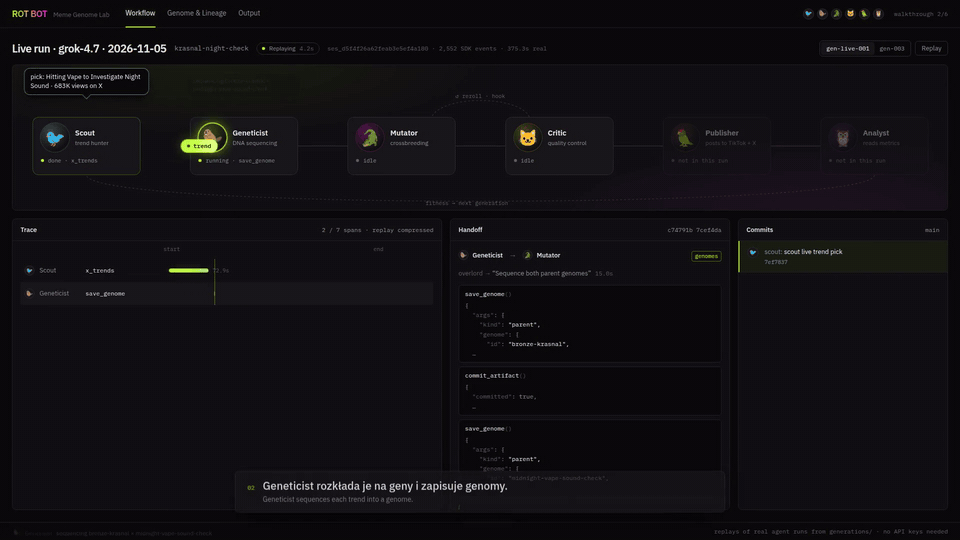
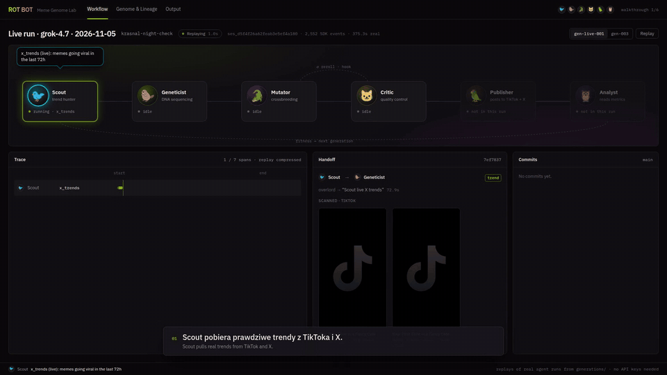
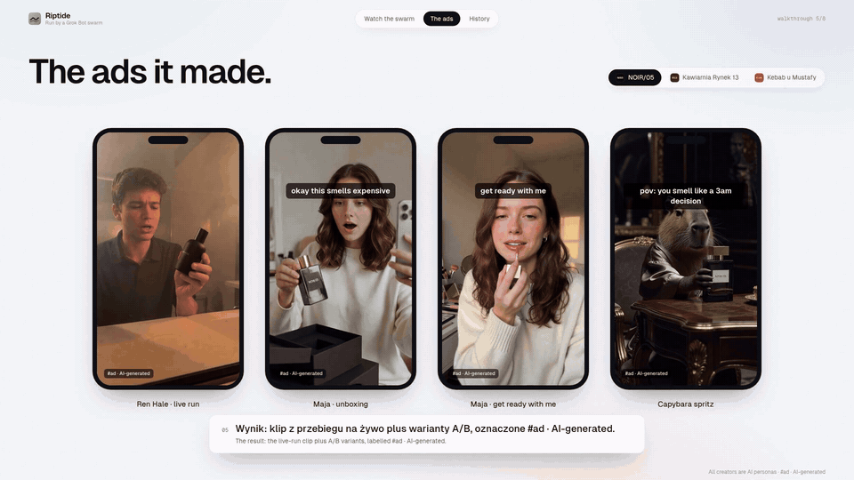
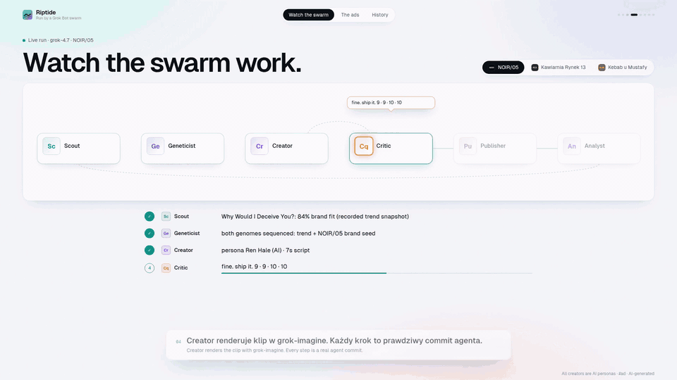
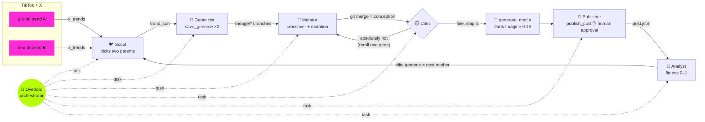
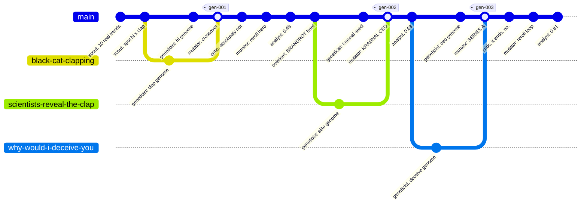

<p align="center">
  
</p>

<p align="center">
  <b>A swarm of Grok Bot agents that hunts viral memes on TikTok + X, sequences their DNA, and breeds new ones.</b><br>
  <i>Zbudowaliśmy gatunek AI, który odkrywa, mutuje i ewoluuje kulturę internetu.</i>
</p>

<p align="center">
  
  
  
  
  
</p>

---

<!-- LIVE RUN: feature generations/gen-live-001/ (RUN.md + trace.ndjson) here once it lands -->

## The pitch

Memes are living organisms. They have DNA, parents and a generation number. **ROT BOT** is a lab where seven
[Grok Bot](agents/) agents breed them like Pokémon: **Scout** 🐦 catches a trend before it peaks,
**Geneticist** 🦫 splits it into eight genes, **Mutator** 🐊 crosses two genomes and mutates the child,
**Critic** 🐱 says *"absolutely not"* until it's good, **Publisher** 🦜 ships it to TikTok and X, and
**Analyst** 🦉 scores its fitness so the winner parents the next generation. Every step is a git commit
signed by the agent that made it, so this repository's history *is* the meme family tree.
Our first lineage went from an orange cat to **Krasnal CEO**, a Wrocław bronze dwarf who just closed his Series A.

## Demo

<p align="center">
  <a href="docs/media/rotbot-demo-45s.mp4"></a><br>
  <b><a href="docs/media/rotbot-demo-45s.mp4">▶ Watch the 45-second demo (mp4)</a></b>
</p>

| 🐦 Trend Radar: real TikTok + X sources | 🐊 Breeding: the hatch | 🦜 Publish + 🦉 Metrics |
| :---: | :---: | :---: |
|  |  |  |

The lab UI (Trend Radar → Genome Lab → Breeding → Studio → Publish → Family Tree → BRANDROT) runs locally:

```bash
npm install && npm run dev
```

## How the swarm works



One generation = one loop. The **Overlord** delegates each step to a subagent with the Grok Bot `task` tool,
the **Critic** can bounce a mutation back up to twice, and the fittest child becomes the mother of the next
generation. A schedule (`bot/schedules/next-generation.md`) breeds a new generation every 6 hours.

## The cast

| | Agent | Animal | Job | Signature move |
| :---: | --- | --- | --- | --- |
| 🐙 | [**Overlord**](agents/bot/instructions.md) | octopus conductor | runs the evolution loop, delegates via `task` | eight arms, seven employees |
| 🐦 | [**Scout**](agents/bot/subagents/scout/instructions.md) | pigeon with binoculars | `x_trends` on X + TikTok, picks parents by velocity | coos exactly once per report |
| 🦫 | [**Geneticist**](agents/bot/subagents/geneticist/instructions.md) | capybara in a lab coat | sequences memes into 8-gene genomes, `save_genome` | finds the one gene that is the meme's soul |
| 🐊 | [**Mutator**](agents/bot/subagents/mutator/instructions.md) | crocodile mad scientist | crossover + 1–3 mutations, commits the git merge, `generate_media` | laughs in three syllables |
| 🐱 | [**Critic**](agents/bot/subagents/critic/instructions.md) | cat in a judge's wig | scores funny / fresh / loopable / brand-safe | *"absolutely not"* |
| 🦜 | [**Publisher**](agents/bot/subagents/publisher/instructions.md) | parrot with a ring light | platform-native TikTok + X posts, `publish_post` | squawks while waiting for approval |
| 🦉 | [**Analyst**](agents/bot/subagents/analyst/instructions.md) | owl in reading glasses | fitness from watch-through, shares, saves, remixes | one owl joke. hoo-ever, never two |

## Built on Grok Bot

[`agents/`](agents/) is a real [`@grok/agent-sdk`](https://cursor.com/docs/bdk) project, scaffolded with
`agent-sdk init` and passing `agent-sdk validate`:

```text
agents/
├── bot/
│   ├── agent.ts                  # Overlord: grok-4.7, reasoning_effort=high
│   ├── instructions.md           # the 7-step evolution loop + house rules
│   ├── subagents/                # scout · geneticist · mutator · critic · publisher · analyst
│   ├── tools/
│   │   ├── x_trends.ts           # xAI x_search (Responses API) → trends, recorded-run fallback
│   │   ├── save_genome.ts        # zod-validated viral DNA → generations/gen-NNN/
│   │   ├── generate_media.ts     # Grok Imagine image / 9:16 video + storyboard.json
│   │   ├── commit_artifact.ts    # git commit as the agent; crossover = git merge --no-ff
│   │   └── publish_post.ts       # X API v2 post, needsApproval: true (a human presses the button)
│   ├── skills/brandrot.md        # "turn any brand into brainrot" procedure
│   ├── schedules/next-generation.md   # cron: breed every 6 hours
│   ├── hooks/memory.ts           # journal of every turn, so Overlord remembers the bloodline
│   └── lib/                      # cast (git identities), genome schema, xAI client
└── evals/smoke.eval.ts           # Overlord must scout via x_trends
```

Every agent has its own git identity, and `commit_artifact` signs each artifact with it:

```ts
export const CAST = {
  scout:      { name: "Scout 🐦",      email: "scout@rotbot.ai" },
  geneticist: { name: "Geneticist 🦫", email: "geneticist@rotbot.ai" },
  mutator:    { name: "Mutator 🐊",    email: "mutator@rotbot.ai" },
  critic:     { name: "Critic 🐱",     email: "critic@rotbot.ai" },
  // ...
};
```

## Viral DNA

Every meme is a genome: eight genes, each an **allele** (what you'd film) and a **dominance** (how much the meme
depends on it). Crossover inherits the more dominant allele; mutations are logged with a reason.
This is the gen-003 champion, [`generations/gen-003/mutation.json`](generations/gen-003/mutation.json) (trimmed):

```json
{
  "id": "krasnal-ceo-series-a",
  "name": "Krasnal CEO: Series A",
  "generation": 3,
  "parents": ["krasnal-ceo", "why-would-i-deceive-you"],
  "genes": {
    "hook":        { "allele": "pitch-deck slide: 'Krasnal AI: we are not a dwarf, we are a Small Language Model'", "dominance": 0.85 },
    "hero":        { "allele": "bronze krasnal CEO in a tiny fleece vest, founder of an AI startup", "dominance": 0.95 },
    "setting":     { "allele": "standing desk on the Rynek cobblestones; a black cat claps in the background", "dominance": 0.7 },
    "humor":       { "allele": "deadpan irony: confident promise, guaranteed disappointment", "dominance": 0.95 },
    "audio":       { "allele": "deadpan voice: 'Why would I deceive you?'", "dominance": 0.9 },
    "catchphrase": { "allele": "Why would a dwarf deceive you?", "dominance": 0.9 },
    "structure":   { "allele": "pitch slide → 'why would a dwarf deceive you?' → black cat claps → hard cut to the first slide (seamless loop)", "dominance": 0.85 }
  },
  "absurdity": 9,
  "brandSafety": 9,
  "mutations": [
    { "gene": "catchphrase", "from": "Why would I deceive you?", "to": "Why would a dwarf deceive you?", "reason": "one-word species swap, the house style since gen-001" },
    { "gene": "structure", "from": "promise → beat of silence → audio drop", "to": "… → black cat claps → hard cut to the first slide (seamless loop)", "reason": "Critic: 'it ends. memes must not end.'" }
  ]
}
```

## Meme family tree

Three generations, bred from real trends the Scout recorded this week
([`generations/sources.json`](generations/sources.json): Know Your Meme's October podium, TikTok's fastest formats).

| Gen | Mother | Father | Child | Critic | Fitness |
| :---: | --- | --- | --- | --- | :---: |
| [001](generations/gen-001/) | Scientists Reveal the Hi 🐈 | Black Cat Clapping 👏 | **Scientists Reveal the Clap** | rejected once (hero), then approved | 0.48 |
| [002](generations/gen-002/) | Wrocław Krasnal *(BRANDROT seed)* | Scientists Reveal the Clap | **Krasnal CEO** | approved first try | 0.63 |
| [003](generations/gen-003/) | Krasnal CEO | Why Would I Deceive You? 🎙️ | **Krasnal CEO: Series A** | rejected once (loop), then approved | **0.81** |



That graph isn't drawn by hand. It's this repo. Run `git log --graph --format='%an: %s' -- generations/`:

```text
* Analyst 🦉: 🦉 analyst: fitness krasnal-ceo-series-a = 0.81
* Publisher 🦜: 🦜 publisher: queue krasnal-ceo-series-a for tiktok + x
* Mutator 🐊: 🐊 mutator: storyboard krasnal-ceo-series-a for grok-imagine-video
* Critic 🐱: 🐱 critic: approve krasnal-ceo-series-a
* Mutator 🐊: 🐊 mutator: reroll structure gene after critique
* Critic 🐱: 🐱 critic: absolutely not (structure)
*   Mutator 🐊: 🐊 mutator: crossover krasnal-ceo × why-would-i-deceive-you → krasnal-ceo-series-a
|\
| * Geneticist 🦫: 🦫 geneticist: sequence why-would-i-deceive-you genome
* | Geneticist 🦫: 🦫 geneticist: sequence krasnal-ceo genome
|/
* Scout 🐦: 🐦 scout: spot why-would-i-deceive-you for the krasnal-ceo bloodline
* Analyst 🦉: 🦉 analyst: fitness krasnal-ceo = 0.63
  ...
*   Mutator 🐊: 🐊 mutator: crossover krasnal-wroclaw × scientists-reveal-the-clap → krasnal-ceo
|\
| * Geneticist 🦫: 🦫 geneticist: sequence scientists-reveal-the-clap genome
* | Geneticist 🦫: 🦫 geneticist: sequence krasnal-wroclaw genome
|/
* Overlord 🐙: 🐙 overlord: open gen-002: BRANDROT brief for Wrocław
  ...
*   Mutator 🐊: 🐊 mutator: crossover scientists-reveal-the-hi × black-cat-clapping → scientists-reveal-the-clap
|\
| * Geneticist 🦫: 🦫 geneticist: sequence black-cat-clapping genome
* | Geneticist 🦫: 🦫 geneticist: sequence scientists-reveal-the-hi genome
|/
* Scout 🐦: 🐦 scout: spot scientists-reveal-the-hi × black-cat-clapping
* Scout 🐦: 🐦 scout: record run scout-2026-11-05: 10 real trends from TikTok + X
```

Each generation folder holds the full lab notebook: `trend.json` → `parents/*/genome.json` → `mutation.json` →
`critique.json` (every round) → `media/storyboard.json` → `post.json` → `metrics.json`.

## BRANDROT: turn any brand into brainrot

Agencies take two weeks to make one "relatable" TikTok. By then the trend is dead.

**BRANDROT** is ROT BOT for brands: the brand becomes a **seed genome** (mascot, place, tagline) and is always the
mother, so it survives every crossover. The swarm pairs it with whatever is rising *right now*, the Critic enforces a
brand-safety floor of 8/10, and a human approves every post. Generation 002 is a worked example: the brief was
**Wrocław** and its 600+ bronze dwarfs; one generation later its mascot is pitching investors.

- **Who pays:** consumer brands, cities and tourism boards, local businesses with no content team.
- **What they get:** a new on-trend meme every 6 hours, a genome per post, and a fitness score that tells them which genes sell.
- **Moat:** the genome library. Every post makes the next generation fitter.

More in [`docs/pitch.md`](docs/pitch.md).

## Real vs simulated

The demo runs on recorded agent runs over real, linked trends; engagement metrics are projected.

## Quickstart

```bash
# the swarm (Node 22.13+)
cd agents && npm install
npx agent-sdk validate --dir .                                   # project is valid
npx agent-sdk tool call x_trends --dir . --input '{"limit":3}'   # no key needed

export CURSOR_API_KEY=...        # Grok Bot model turns
export XAI_API_KEY=...           # optional: live x_search + Grok Imagine
npx agent-sdk run --dir . --message "Breed the next generation."
npx agent-sdk dev                # playground at http://127.0.0.1:3000/playground

# the lab UI (repo root)
npm install && npm run dev
```

Brand mode: `npx agent-sdk run --dir . --message "BRANDROT: Żabka. Turn it into brainrot."`

## Team

**Opalacze**: see [TEAM.md](TEAM.md). Built in one hackathon evening, with a swarm doing a lot of the work.
